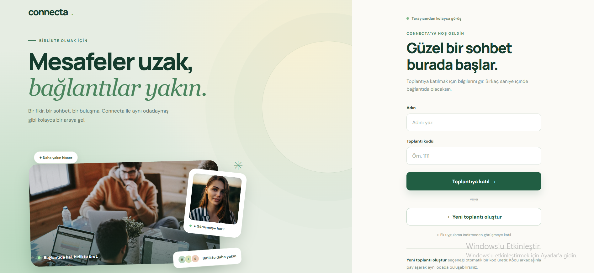
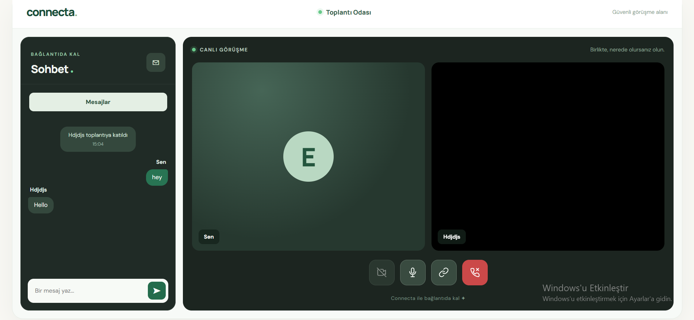

<div align="center">

# Connecta

**Closer conversations, wherever you are.**

A browser-based, two-person video calling and messaging application built with WebRTC, WebSocket, Node.js, and Express.

[**Try the live demo**](https://connecta-qxkx.onrender.com)

</div>

## Preview

**Welcome screen**



**Meeting room**



## Features

- **One-to-one meetings:** Create a meeting room or join an existing room using its code.
- **Real-time audio and video:** Browser-based peer-to-peer media communication with WebRTC.
- **Instant messaging:** Exchange text messages with the other participant during a meeting.
- **Call controls:** Toggle your camera and microphone, and leave a meeting.
- **Participant feedback:** See the other participant's name or avatar when video is unavailable.
- **Rejoining:** Leave and join the same room again without restarting the application.
- **Browser access:** No separate application installation required.

> Connecta currently supports a maximum of **two participants per room**.

## Tech Stack

| Layer | Technology | Purpose |
| --- | --- | --- |
| Frontend | HTML, CSS, JavaScript | Interface and browser interactions |
| Real-time media | WebRTC | Audio/video connections between participants |
| Signaling | WebSocket (`ws`) | Exchange offers, answers, ICE candidates, and room events |
| Backend | Node.js, Express | HTTP server and static file hosting |
| Deployment | Render | Live application hosting |

## How It Works

1. A participant creates or joins a room using a meeting code.
2. The Node.js WebSocket server assigns roles and relays signaling messages between participants.
3. The browsers exchange WebRTC session descriptions and ICE candidates.
4. WebRTC carries the audio/video streams; WebSocket handles signaling, chat messages, and participant events.
5. When someone leaves, the remaining participant receives a departure notification and can wait for a new participant.

## Run Locally

**Requirements:** Node.js 20 or newer and npm.

```bash
git clone https://github.com/rabiaceylan/connecta.git
cd connecta
npm install
npm start
```

Open **http://localhost:3001** in your browser.

**Important:** The deployed server currently uses an Origin allowlist that permits `https://connecta-qxkx.onrender.com`. To use WebSocket features locally, add `http://localhost:3001` to the `allowedOrigins` set in `server.js` for local development. Do not remove Origin checks in production.

On Windows PowerShell, if script execution restrictions prevent `npm` from running, use `npm.cmd install` and `npm.cmd start` instead.

## Configuration

The server reads the port from the `PORT` environment variable and otherwise defaults to `3001`:

```js
const PORT = Number(process.env.PORT) || 3001;
```

No database is required for the current room-based application. Rooms and participant state are maintained in server memory.

## Security Considerations

Connecta includes several baseline protections:

- Server-side room capacity limit of two participants.
- Validation of room names, display names, and chat-message length.
- WebSocket Origin allowlist for browser connections.
- WebSocket message payload limit of 16 KiB.
- Environment files excluded from Git by `.gitignore`.

**Limitations:** Origin validation is not authentication, and meeting codes are not a substitute for access control. The application does not currently claim end-to-end identity verification, rate limiting, or protection against all forms of abuse. WebRTC media transport uses its standard encrypted transport, but this should not be confused with a separately audited end-to-end security design.

## Current Scope

Connecta is a learning and portfolio project focused on **one-to-one** communication. Group calling, screen sharing, persistent chat history, and user accounts are outside its current scope.

## Project Structure

```text
connecta/
├── public/
│   └── index.html        # User interface and client-side logic
├── docs/
│   └── screenshots/
│       ├── home.png
│       └── meeting.png
├── server.js             # Express server and WebSocket signaling
├── package.json
├── package-lock.json
├── .gitignore
└── README.md
```

## Author

Developed by [Rabia Ceylan](https://github.com/rabiaceylan).
